<p align="center">
  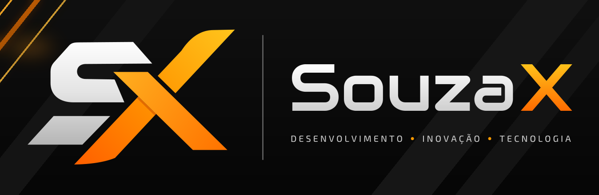
</p>

<h1 align="center">SouzaX · Pacote de Marca</h1>

<p align="center">
  Identidade visual completa da <strong>SouzaX</strong>: logos, ícones, favicons, banners para redes sociais,<br>
  ícones de sistema (Windows/macOS) e ícones de PWA, prontos para usar em sites, apps e materiais de divulgação.
</p>

<p align="center">
  
  
  
</p>

---

## 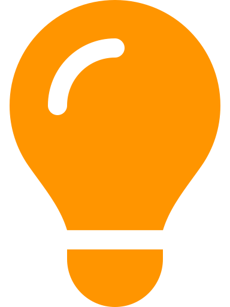 Sobre o repositório

Este repositório reúne **todos os arquivos da marca SouzaX em um só lugar**, organizados por finalidade. A ideia é que qualquer pessoa (desenvolvedor, designer ou parceiro) encontre rapidamente a versão certa do logo para cada situação, sem precisar exportar ou redimensionar nada:

- **Precisa do logo num site?** Use o SVG em `00-logo-principal`.
- **Vai configurar o favicon?** Está tudo em `02-favicon-e-apps`.
- **Vai postar nas redes sociais?** Os banners já estão no tamanho certo em `03-banner-redes-sociais`.
- **Vai gerar um instalador ou PWA?** Use `06-programas-e-sistema` e `07-pwa`.

Nos arquivos SVG os textos já estão **convertidos em curvas**, então não é preciso ter as fontes instaladas.

## 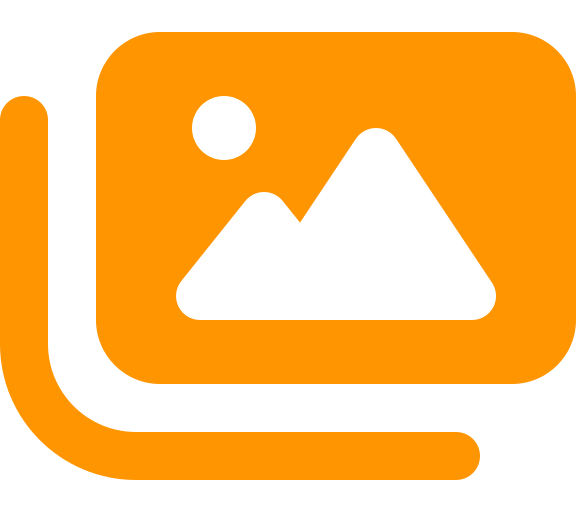 Visão geral

<p align="center">
  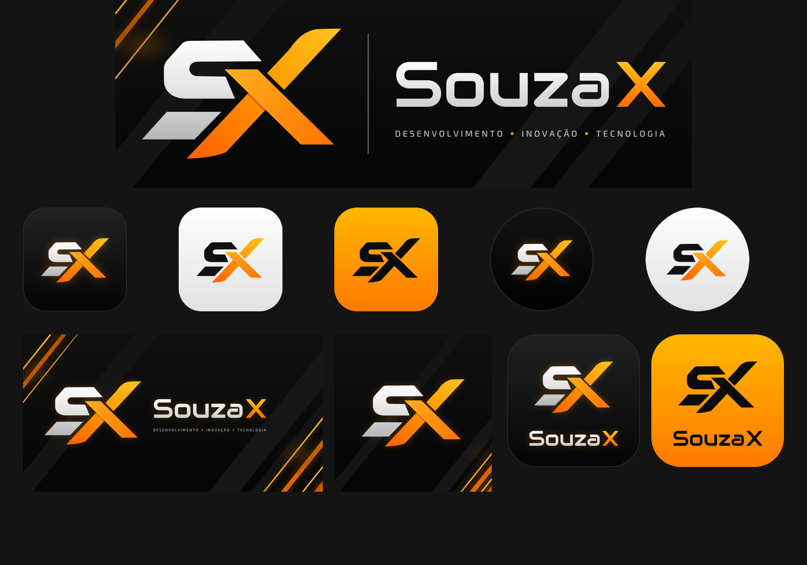
</p>

---

## 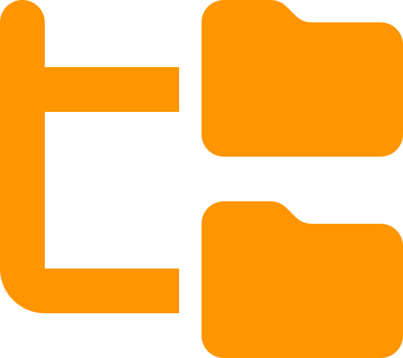 Estrutura

```
souzax-brand/
├── 00-logo-principal/        Logo horizontal (símbolo + nome + slogan)
├── 01-icone-principal/       Símbolo SX transparente (32 a 512 px + SVG)
├── 02-favicon-e-apps/        Favicons, apple-touch-icon e ícones de app
├── 03-banner-redes-sociais/  OG Image, Twitter/X, Instagram, LinkedIn
├── 04-marcas-versoes/        Logo empilhada (escura, branca, laranja)
├── 05-versoes-de-cores/      Colorida, branca, preta e laranja
├── 06-programas-e-sistema/   Ícones Windows (.ico) e macOS (.icns)
├── 07-pwa/                   Ícones PWA + manifest.json
├── 08-outros-formatos/       Símbolo em SVG, PNG, ICO e ICNS
├── assets/icons/             Ícones Font Awesome usados neste README
└── 00-visao-geral.png        Painel com todas as variações
```

| Pasta | Conteúdo |
|---|---|
| [`00-logo-principal`](00-logo-principal) | Logo horizontal: SVG, PNG transparente, PNG com fundo escuro e versão para fundo claro |
| [`01-icone-principal`](01-icone-principal) | Símbolo SX transparente: 512, 256, 128, 64 e 32 px + SVG |
| [`02-favicon-e-apps`](02-favicon-e-apps) | App escuro 512 (PNG e ICO), branco, laranja, redondo preto/branco 180, `favicon.ico` (16/32/48), favicons PNG e `apple-touch-icon` |
| [`03-banner-redes-sociais`](03-banner-redes-sociais) | OG Image 1200×630, Twitter/X 800×418, Instagram 1080×1080, LinkedIn 400×400 |
| [`04-marcas-versoes`](04-marcas-versoes) | Logo empilhada 400×400 (escura, branca, laranja) e símbolo transparente, em PNG e SVG |
| [`05-versoes-de-cores`](05-versoes-de-cores) | Colorida, branca, preta e laranja (PNG 512 e SVG) + colorida para fundo claro |
| [`06-programas-e-sistema`](06-programas-e-sistema) | Windows: ICO e PNG de 16 a 256 px · macOS: ICNS e PNG 1024 |
| [`07-pwa`](07-pwa) | Ícones de 72 a 512 px, versões *maskable* e `manifest.json` |
| [`08-outros-formatos`](08-outros-formatos) | SVG, PNG, ICO e ICNS do símbolo |

---

##  Logo principal

| Fundo escuro | Fundo claro |
|:---:|:---:|
|  | 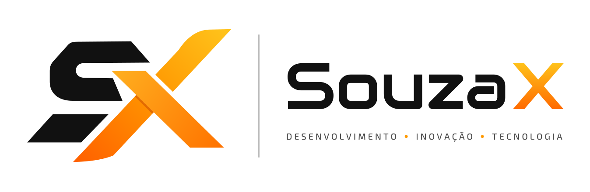 |
| `souzax-logo-horizontal-fundo-escuro.png` | `souzax-logo-horizontal-fundo-claro.png` |

Também disponível com fundo transparente: [`souzax-logo-horizontal-transparente.png`](00-logo-principal/souzax-logo-horizontal-transparente.png) e em vetor: [`souzax-logo-horizontal.svg`](00-logo-principal/souzax-logo-horizontal.svg).

## 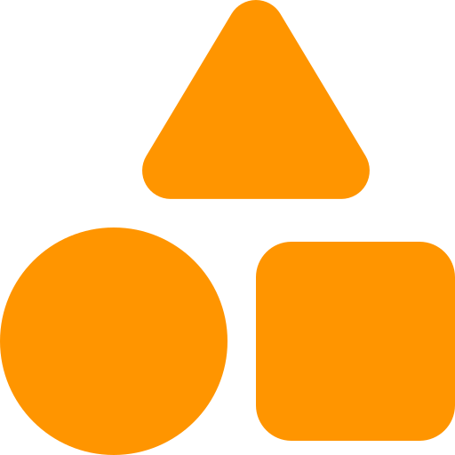 Ícone principal

<p>
  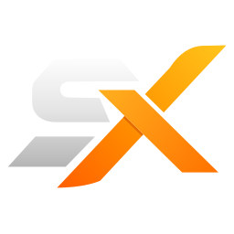
  
  
  
</p>

Tamanhos: 512, 256, 128, 64 e 32 px + [`souzax-icone.svg`](01-icone-principal/souzax-icone.svg).

## 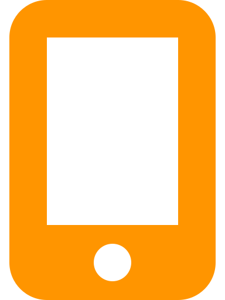 Favicon e ícones de app

| Escuro | Branco | Laranja | Redondo preto | Redondo branco |
|:---:|:---:|:---:|:---:|:---:|
| 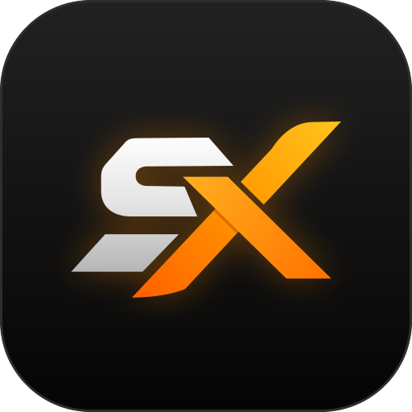 | 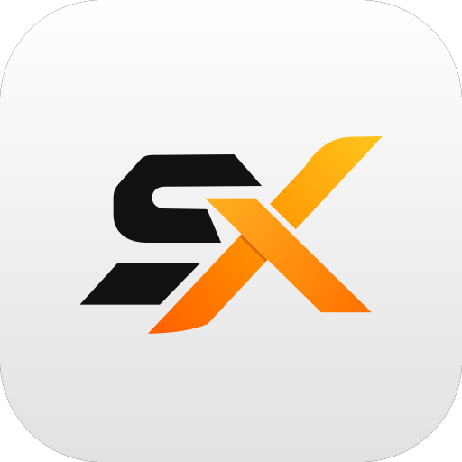 | 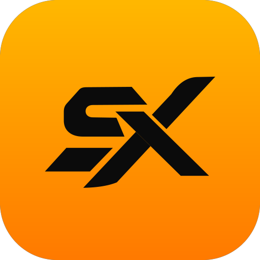 | 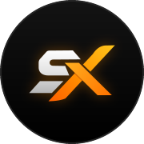 |  |
| 512×512 | 512×512 | 512×512 | 180×180 | 180×180 |

## 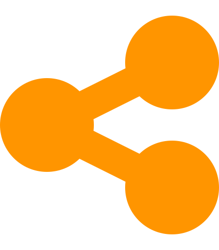 Banners para redes sociais

| OG Image (1200×630) | Twitter / X (800×418) |
|:---:|:---:|
| 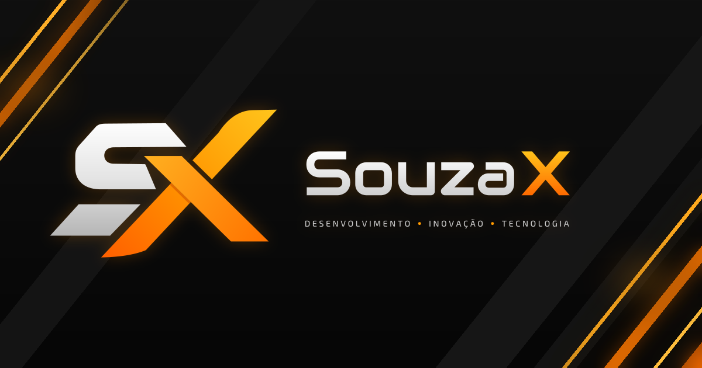 | 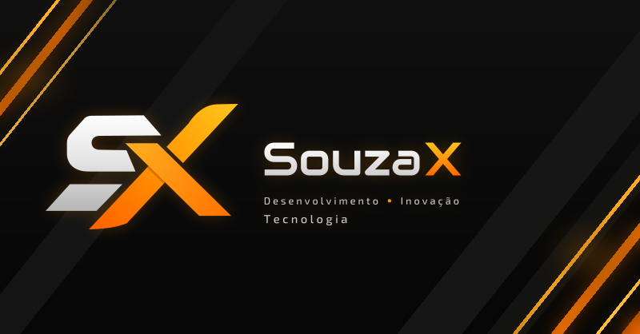 |

| Instagram (1080×1080) | LinkedIn (400×400) |
|:---:|:---:|
| 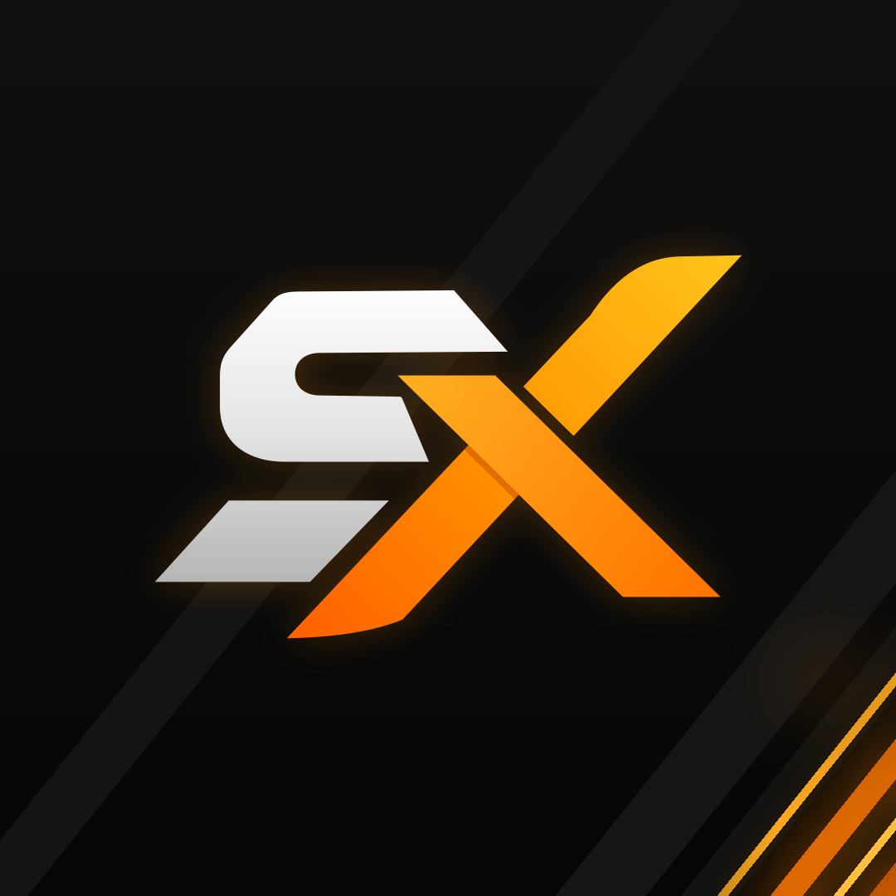 | 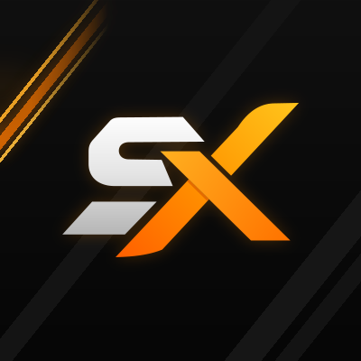 |

## 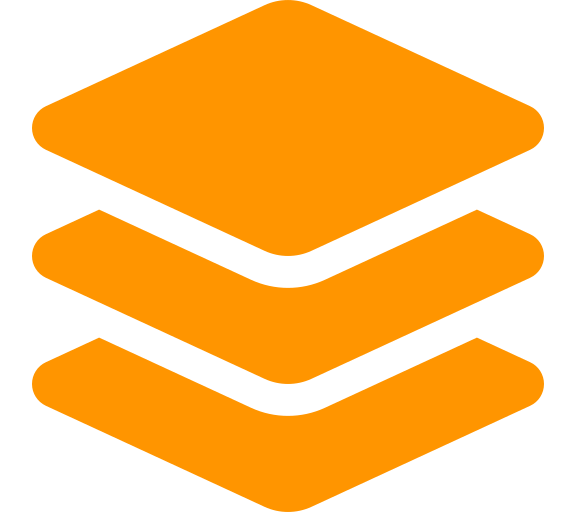 Logo empilhada

| Escura | Branca | Laranja | Símbolo transparente |
|:---:|:---:|:---:|:---:|
| 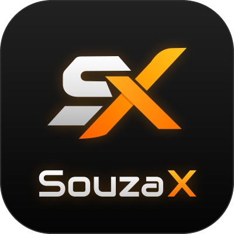 |  | 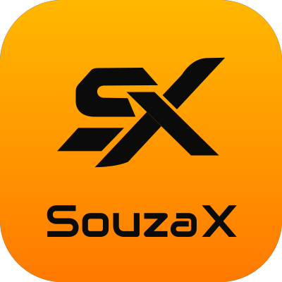 | 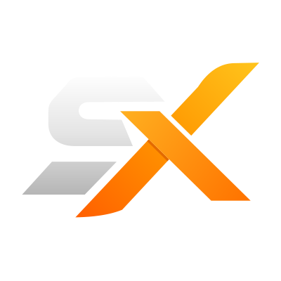 |

## 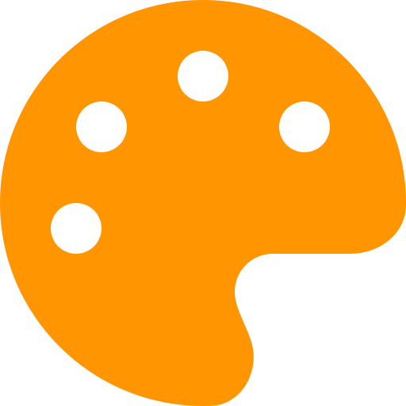 Versões de cores

| Colorida | Fundo escuro | Fundo claro | Laranja | Branca | Preta |
|:---:|:---:|:---:|:---:|:---:|:---:|
| 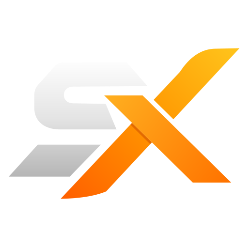 |  | 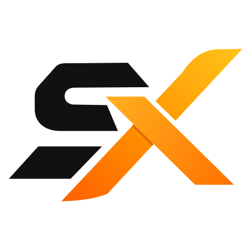 | 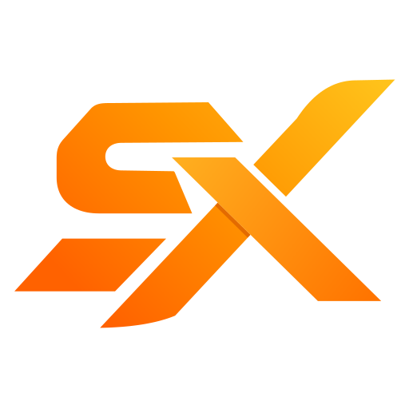 |  | 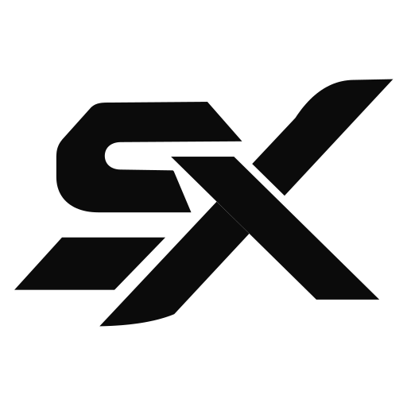 |

> A versão **branca** é transparente e pode ficar invisível no tema claro do GitHub; a **preta**, no tema escuro. Os arquivos estão corretos.

## 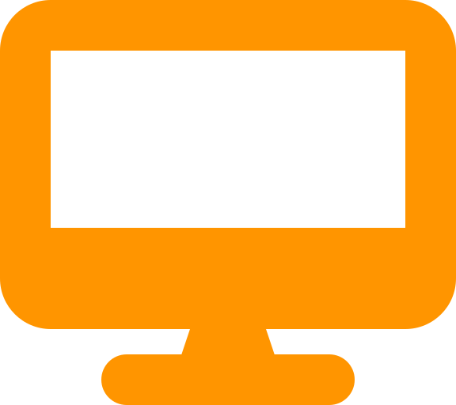 Programas e sistema

| Windows (`.ico` + PNG 16–256 px) | macOS (`.icns` + PNG 1024 px) |
|:---:|:---:|
|  | 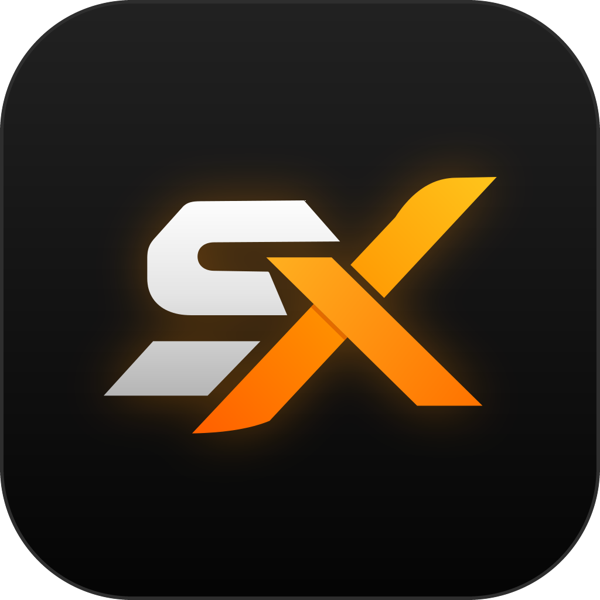 |

## 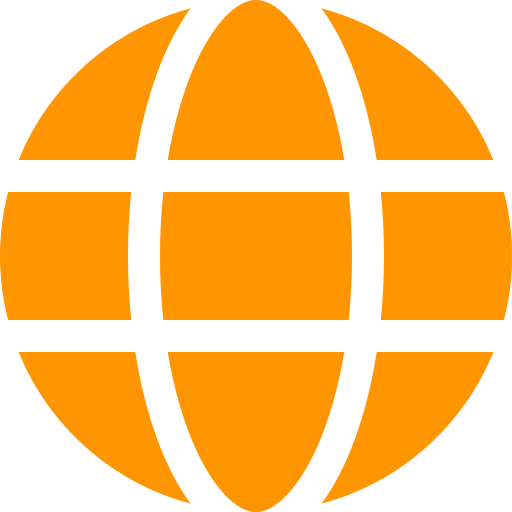 PWA

<p>
  
  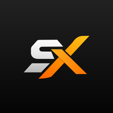
</p>

Ícones de 72, 96, 128, 144, 152, 192, 384 e 512 px, versões *maskable* (192 e 512) e o [`manifest.json`](07-pwa/manifest.json) já configurado.

---

## 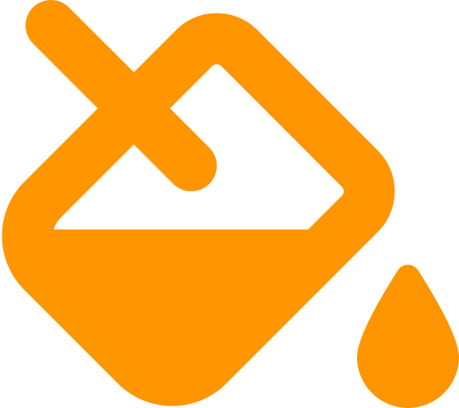 Paleta de cores

| Uso | Cor | Hex |
|---|---|---|
| Laranja (degradê) |    | `#FFC21A` → `#FF9500` → `#FF6200` |
| Prata do "S" (degradê) |   | `#FFFFFF` → `#B4B4B4` |
| Fundo |  | `#0A0A0A` |

## 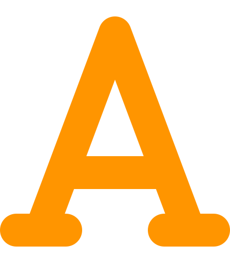 Tipografia

| Elemento | Fonte |
|---|---|
| Nome **SouzaX** | [Audiowide](https://fonts.google.com/specimen/Audiowide) |
| Slogan *Desenvolvimento • Inovação • Tecnologia* | [Exo 2](https://fonts.google.com/specimen/Exo+2) Medium |

---

## 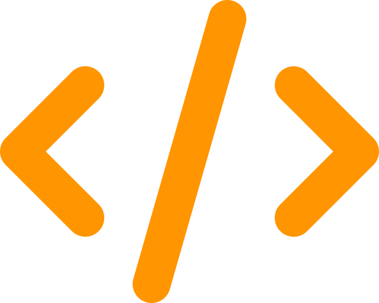 Como usar no site

1. Copie para a raiz pública do projeto:
   - `02-favicon-e-apps/favicon.ico`
   - `02-favicon-e-apps/apple-touch-icon.png`
   - o conteúdo da pasta `07-pwa` (`manifest.json` + pasta `icons/`)
   - `03-banner-redes-sociais/og-image-1200x630.png`
2. Adicione no `<head>`:

```html
<link rel="icon" href="/favicon.ico" sizes="any">
<link rel="apple-touch-icon" href="/apple-touch-icon.png">
<link rel="manifest" href="/manifest.json">
<meta name="theme-color" content="#0A0A0A">
<meta property="og:image" content="https://SEU-DOMINIO/og-image-1200x630.png">
```

## 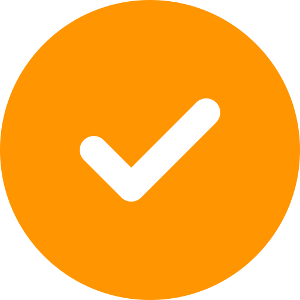 Boas práticas de uso

- Prefira os arquivos **SVG** sempre que possível (escalam sem perder qualidade).
- Em fundos escuros, use a versão **colorida** ou **branca**; em fundos claros, a **colorida para fundo claro** ou **preta**.
- Não distorça, rotacione nem altere as cores da marca.
- Mantenha uma área de respiro ao redor do logo.

---

<p align="center">
  <br>
  <sub><strong>SouzaX</strong> · Desenvolvimento • Inovação • Tecnologia</sub><br>
  <sub>Ícones: <a href="https://fontawesome.com">Font Awesome Free</a> (CC BY 4.0)</sub>
</p>
